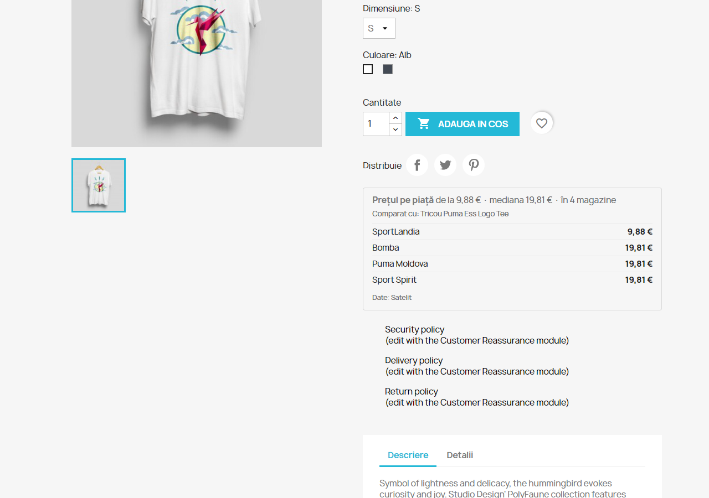
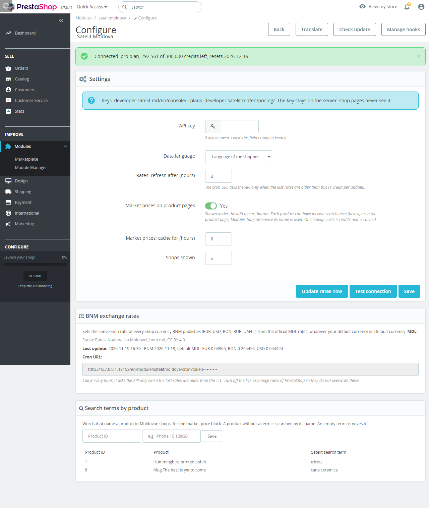

# Satelit for PrestaShop

PrestaShop module **`satelitmoldova`**: official National Bank of Moldova (BNM) exchange rates for your shop currencies, and a **"Market price"** block on product pages with offers from Moldovan shops, through the [Satelit API](https://developer.satelit.md/en/docs/). PrestaShop 1.7.8 and 8.x.



Real output from a test shop (PrestaShop 1.7.8.11, default currency MDL) after **Update rates now**:

```
2026-11-19 16:36 · BNM 2026-11-19, default MDL: EUR 0.04965, RON 0.265456, USD 0.054424
```

and the block on a t-shirt page (search term `tricou`, shop language Romanian):

```
Prețul pe piață  de la 199,00 MDL · mediana 399,00 MDL · în 4 magazine
Comparat cu: Tricou Puma Ess Logo Tee
SportLandia 199,00 MDL · Bomba 399,00 MDL · Puma Moldova 399,00 MDL · Sport Spirit 399,00 MDL
Date: Satelit
```

## What it does

**BNM exchange rates.** Sets the conversion rate of every shop currency BNM publishes (EUR, USD, RON, RUB, UAH, …) from `/v1/rates`. BNM quotes MDL per `nominal` units. The module converts that to PrestaShop's model (the default currency is 1, every other currency is "units per 1 unit of the default", 6 decimals), so any default currency works:

| Default currency | EUR | MDL | USD |
|---|---|---|---|
| MDL | `nominal / value` = 0.049650 | 1 | 0.054424 |
| EUR | 1 | 20.141100 | 1.096150 |

Currencies BNM does not list are left alone and named in the log line. If the default currency has no BNM rate, nothing changes. Run it with **Update rates now** on the configuration page or the **cron URL** (`index.php?fc=module&module=satelitmoldova&controller=cron&token=…`), which calls the API only when the last rates are older than the TTL.

**Market prices.** On the product page (hook `displayProductAdditionalInfo`, under the add to cart button): it searches Satelit for the product, opens the best match and shows the lowest and median price, the number of shops and the cheapest offer of up to N shops, each with the shop name. Prices come in MDL and are shown in the shopper's currency when the shop has MDL. Each product can have its own **Satelit search term**: in the product page's Modules tab (PrestaShop 1.7.8 and the classic product page of 8.x), and always in **Search terms by product** on the configuration page (the newer product page of 8.1+ does not show module fields). Otherwise the product name is used.

**Configuration** (`Modules > Module Manager > Satelit Moldova > Configure`): API key (password field, never shown again, kept when left empty), data language (shopper's language or a fixed one: ro, ru, en, uk), rates TTL, prices TTL, number of shops, on/off, **Test connection** (plan and credits left, from `/v1/me`, 0 credits), the last rates log line, the cron URL and the search terms. Translations: English, Romanian, Russian.



## Requirements

- PrestaShop 1.7.8.x or 8.x (see "Tested with"), PHP 7.1+ with `curl` (falls back to `file_get_contents`).
- A Satelit API key. There is no free plan: try the data first with the keyless `/v1/sample` or the [console](https://developer.satelit.md/en/console/), then pick a plan on the [pricing page](https://developer.satelit.md/en/pricing/).
- The Moldovan leu (MDL) among your currencies if you want market prices converted to the shopper's currency.

## Install

```bash
python tools/build.py      # dist/satelitmoldova.zip
```

1. `Modules > Module Manager > Upload a module`, drop `satelitmoldova.zip`. (Or unzip it into `modules/` and run `php bin/console prestashop:module install satelitmoldova`.)
2. **Configure**: paste the key, **Test connection**, Save.
3. **Update rates now**, then put the cron URL in your crontab, e.g. every hour:
   `0 * * * * curl -s "https://shop.example/index.php?fc=module&module=satelitmoldova&controller=cron&token=…"`
   It answers one JSON line, `{"ok":true,"message":"fresh"}` while the rates are younger than the TTL. Add `&force=1` to update now. A wrong token answers 403.
4. Turn off PrestaShop's own live exchange rates (`International > Localization > Currencies`) so they do not overwrite the BNM ones.

Uninstalling removes the settings and the module's two tables (`satelit_cache`, `satelit_product`).

## Caching and credits

| What | API calls | Credits | Cached |
|---|---|---|---|
| Rates update | `GET /v1/rates` | 1 | rates TTL, 3 h by default (BNM publishes once a day) |
| Market prices for a product | `GET /v1/prices/search` + `GET /v1/prices/items/{id}` | 3 + 2 | prices TTL, 6 h by default, per search term and language; "no match" is cached too |
| Test connection | `GET /v1/me` | 0 | no |

When the API fails (bad key, quota, network), the shop keeps its rates, the product page shows the last cached copy or nothing, a short line goes to `Advanced Parameters > Logs`, and the module waits 10 minutes before calling again. Product page calls time out after 5 s, back office calls after 8 s.

## Security

- The key is stored in the PrestaShop configuration and only read on the server. The form never prints it back and it is never sent to the shop pages.
- The configuration page is protected by PrestaShop's AdminModules token and the module's `configure` permission.
- Values from the API are escaped in the templates (`|escape:'html':'UTF-8'`). The cron URL needs a random 32-character token compared with `hash_equals`.

## Troubleshooting

- **"key_invalid"** on Test connection: the key is wrong or revoked. Make a new one in the [console](https://developer.satelit.md/en/console/).
- **No block on a product page**: check "Market prices on product pages", the hook position in `Design > Positions`, and that the search term finds something ("no match" is cached for the prices TTL, saving the settings or a search term clears that cache).
- **Rates do not change**: the default currency must be MDL or a currency BNM lists. The "Last update" line says what happened.
- **A changed template does not show**: clear the cache in `Advanced Parameters > Performance`.

## Tested with

Verified on 19 Nov 2026 against the live API with the official Docker images (CLI auto-install), MariaDB 10.11.19:

| Shop | PHP | Installed via | Checks |
|---|---|---|---|
| PrestaShop 1.7.8.11 (default currency MDL, languages en + ro) | 7.4.33 | unzip into `modules/` + `bin/console prestashop:module install` | configure, Test connection, Update rates now, cron URL, search term from the product page and the configuration, product page (en, ro), bad key, dead API |
| PrestaShop 8.2.9 (default currency EUR, languages en + ro) | 8.1.34 | `Module Manager > Upload a module` | the same. Search term from the configuration |

Offline tests (`php tests/run.php`) pass on PHP 7.2 and 8.3.

## Development

```bash
php tests/run.php                   # offline: PrestaShop classes and HTTP faked, fixtures from the live API
python tools/translations.py        # writes translations/ro.php and ru.php from the table in the script
SATELIT_API_KEY=… php tests/live.php     # optional live smoke test (about 6 credits)
```

## Pe scurt (română)

Modulul `satelitmoldova` pentru PrestaShop 1.7.8 și 8.x pune în valutele magazinului cursurile oficiale BNM (prin `/v1/rates`, cu MDL ca bază, oricare ar fi valuta implicită) și arată pe pagina produsului blocul „Prețul pe piață”: prețul minim, mediana și magazinele din Moldova care vând produsul. Se încarcă din `Module > Manager module > Încarcă un modul`, cheia se pune în configurarea modulului, cursurile se actualizează cu „Actualizează cursurile acum” sau prin adresa pentru cron cu token. Totul e păstrat în cache (cursurile 3 ore, prețurile 6 ore). Dacă API-ul nu răspunde, magazinul merge mai departe. Traduceri în română, rusă și engleză.

## License

MIT, see [LICENSE](LICENSE). Rates: Sursa: Banca Națională a Moldovei, bnm.md, CC BY 4.0. Data: [Satelit](https://satelit.md).
